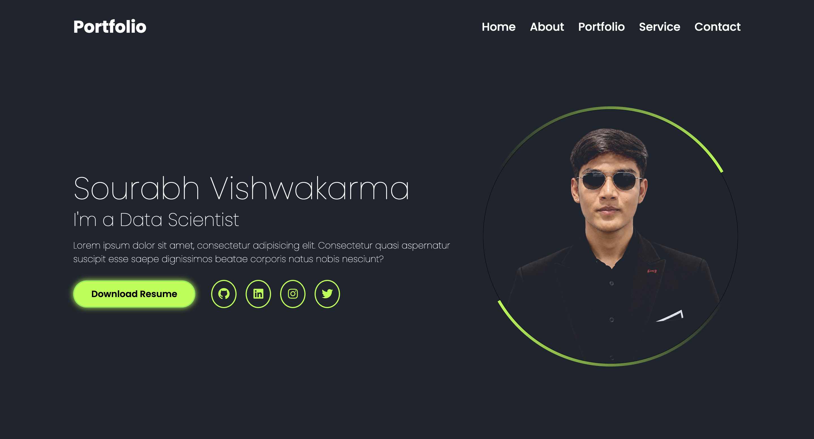

Sourabh Vishwakarma | Personal Portfolio

A professional portfolio showcasing my technical skills, projects, and development journey.

 
 

⸻

📌 Overview

This is my personal portfolio website, developed to establish a professional online presence and showcase my technical background, skills, projects, and achievements.

The website features a modern dark-themed interface with neon-green accents, CSS animations, and a responsive layout. It provides visitors with an organized overview of my professional profile and makes my resume, projects, and social profiles easily accessible.

The primary objective of this project is to present my work and technical capabilities through a clean, user-friendly web experience.

✨ Key Features

* Modern UI Design: Clean dark-themed interface with neon-green accents.
* Animated Profile Section: Rotating animated border around the profile image using CSS.
* Professional Introduction: Dedicated homepage introducing my background and technical interests.
* About Section: Information about my educational and professional background.
* Skills Section: Organized presentation of technical skills and technologies.
* Projects Section: Showcase of technical projects and practical implementations.
* Functional Navigation: Navigation links connected to their respective sections.
* Resume Download: Direct access to my downloadable resume.
* Social Media Integration: Direct links to GitHub, LinkedIn, and other professional profiles.
* Responsive Design: Layout optimized for desktop, tablet, and mobile screens.

🛠️ Technologies Used

Technology	Purpose
HTML5	Website structure and content
CSS3	Styling, layouts, and animations
Google Fonts	Poppins typography
Font Awesome	Social media and interface icons
CSS Media Queries	Responsive design

📸 Website Preview

Homepage

Project Demonstration

▶ Watch Portfolio Demo Video

📂 Project Structure

personal-portfolio-website/
│
├── assets/
│   ├── Dashboard.png
│   ├── Demo.mov
│   ├── Sourabh_Vishwakarma_Resume.pdf
│   └── image.png
│
├── index.html
├── style.css
└── README.md

🌐 Live Deployment
https://personal-portfolio-website-hazel-beta.vercel.app/

The portfolio website is intended to be deployed using Vercel.

Once deployed, you can access the website through the live demo link provided at the top of this README.

Live Website: Visit My Portfolio

About Me

Sourabh Vishwakarma

I am interested in Data Science, Machine Learning, Artificial Intelligence, and Software Development.

I enjoy building practical projects, exploring new technologies, and continuously improving my technical skills.

Connect With Me

⸻

Thank you for visiting my repository!

If you find this project interesting, feel free to explore the code and share your feedback.

